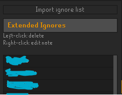

# Extended Ignore List

Keep a plugin-managed list of ignored players beyond RuneScape's native ignore-list limit.

## Manage your list

- Add players from the player menu, the native ignore-list menu, or the extended-list panel. Use **Import ignore list** to copy your current native list.
- Left-click a row to remove it; right-click to add or edit a note. Extended-list entries do not automatically add players to your native ignore list.
- Names and aliases are tracked across renames. Notes are saved with the extended list; available Friend Notes are copied into empty notes when adding or importing.
- Choose **Name A-Z**, **Name Z-A**, **Oldest first**, or **Newest first** from the panel's sort menu.
- Manual native ignore additions sync into the extended list only after the name appears in the native list. Rejected or cancelled additions are not tracked. Syncing removals is optional in plugin settings.

## Alerting

Configure these in the plugin settings:

- Hide extended-ignored players in the scene and hide their incoming trade requests.
- Highlight ignored names on supported raid and Barbarian Assault lists (on by default).
- Get a chat message or RuneLite notification when an ignored player is in your raid group or Barbarian Assault team. Alerts are chat-only by default; you can disable them or censor names.

Supported raids are Chambers of Xeric, Theatre of Blood, Tombs of Amascut, and The Fractured Archive. Fractured Archive support includes party boards, member/applicant lists, the lobby roster, and in-raid HUD initials matched against full player names. Group alerts apply to your own party, not parties you merely browse or externally spectate.

## Syncing

The extended list, aliases, and notes are shared across RuneScape accounts and RuneLite profiles. Plugin settings remain profile-specific. To sync between computers, sign in to the same RuneLite account and allow RuneLite's normal cloud sync to complete. Avoid editing the list on multiple computers at the same time.

Existing lists are merged into the shared list automatically. Switch to each older RuneLite profile once to migrate its list. Importing reads only the currently logged-in account's native ignore list.
